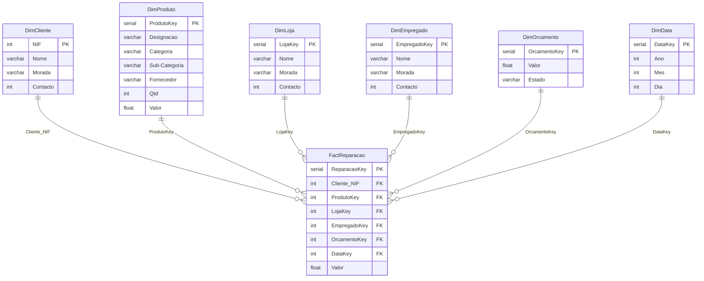

# Data Warehouse — Loja de Reparação de Tecnologia

Modelação dimensional (*star schema*) e implementação em **PostgreSQL** de um data warehouse para analisar reparações, orçamentos, produtos e desempenho de uma cadeia de lojas de reparação de tecnologia.

> Projeto académico · Pós-Graduação em Big Data & Decision Making (ISEP, 2025/2026) · Projeto de grupo (3 elementos)

**Stack:** PostgreSQL · SQL (DDL / DML) · DBeaver · Modelação dimensional

📄 **Apresentação:** [`docs/apresentacao-dw-loja-reparacao.pdf`](docs/apresentacao-dw-loja-reparacao.pdf)

---

## Objetivo

Uma empresa de tecnologia com várias lojas de reparação quer analisar a sua atividade. O objetivo foi desenhar e implementar um data warehouse que responda a três perguntas de negócio:

| Pergunta de negócio | O que se analisa |
|---|---|
| **Reparações vs Orçamentos** | Valor orçamentado vs valor da reparação, por estado do orçamento |
| **Produto em destaque** | Produtos com mais reparações e maior valor associado |
| **Análise temporal** | Evolução do nº de reparações e do valor por ano e mês |

## Abordagem

1. **Modelo conceptual:** entidades do negócio (Empresa, Loja, Empregado, Cliente, Produto, Orçamento, Reparação) e respetivas relações.
2. **Modelo lógico:** atributos e chaves de cada entidade.
3. **Modelo físico:** *star schema* com a reparação como facto central.
4. **Implementação em PostgreSQL:** schema, tabelas, chaves estrangeiras e índices.
5. **Carga e manipulação de dados:** `INSERT`, `UPDATE` e `DELETE`.
6. **Queries analíticas:** `JOIN`, agregações e filtros para responder às perguntas de negócio.

## Modelo dimensional



- **Tabela de factos:** `FactReparacao`, com uma linha por reparação (cliente, produto, loja, empregado, orçamento e data) e a medida `Valor`.
- **Dimensões:** Cliente, Produto, Loja, Empregado, Orçamento e Data.

### Decisões de implementação

- Schema dedicado: `dw_schema_lojas`.
- Script de criação re-executável: `DROP TABLE IF EXISTS … CASCADE` antes de criar as tabelas.
- Chaves substitutas `SERIAL` nas dimensões (a `DimCliente` usa o NIF como chave).
- Chaves estrangeiras na tabela de factos com `ON DELETE CASCADE`.
- Índices em todas as chaves estrangeiras da tabela de factos.

## Estrutura do repositório

```
dw-loja-reparacao/
├── README.md
├── sql/
│   ├── create_bd.sql                  # schema, tabelas, FKs e índices
│   ├── insert.sql                     # dados de exemplo (fictícios)
│   └── updates_delete_analytics.sql   # updates, deletes e queries analíticas
└── docs/
    └── apresentacao-dw-loja-reparacao.pdf
```

## Como executar

**Requisitos:** PostgreSQL (testado na versão 16) e `psql` ou DBeaver.

```bash
# 1. Criar a base de dados
createdb dw_lojas

# 2. Criar o schema e as tabelas
psql -d dw_lojas -f sql/create_bd.sql

# 3. Carregar os dados de exemplo
psql -d dw_lojas -f sql/insert.sql

# 4. Executar updates, deletes e queries analíticas
PGOPTIONS="-c search_path=dw_schema_lojas" psql -d dw_lojas -f sql/updates_delete_analytics.sql
```

> **Nota:** as queries analíticas referem as tabelas sem o prefixo do schema; o `search_path` garante que são encontradas. No DBeaver, basta definir `dw_schema_lojas` como schema ativo antes de correr o script.

## Queries analíticas

| # | Pergunta | Técnicas SQL |
|---|---|---|
| 1 | Reparações vs orçamentos, por estado | `JOIN` (3 tabelas), `COUNT` / `SUM` / `AVG`, `GROUP BY` |
| 2 | Nº de reparações e valor total por produto | `JOIN`, agregação, `ORDER BY` |
| 3 | Valor gasto por cliente | `JOIN`, `SUM` |
| 4 | Produtos reparados em janeiro | `JOIN`, `WHERE`, `COUNT` |
| 5 | Nº de reparações e valor por ano e mês | `JOIN` com `DimData`, agregação temporal |
| 6 | Desempenho por empregado, por ano e mês | `JOIN`, `COUNT` / `SUM` / `AVG` |

## Resultados

Resultados obtidos com os dados de exemplo, depois dos updates e deletes do script.

**Reparações vs Orçamentos (por estado)**

| Estado | Nº registos | Total orçamento | Total reparação | Média orçamento | Média reparação |
|---|--:|--:|--:|--:|--:|
| Aprovado | 5 | 4 930 | 4 950 | 986,00 | 990,00 |
| Rejeitado | 1 | 12 | 12 | 12,00 | 12,00 |

**Análise temporal (ano / mês)**

| Ano | Mês | Valor total | Nº reparações |
|---|--:|--:|--:|
| 2025 | 1 | 4 875 | 4 |
| 2025 | 2 | 75 | 1 |
| 2025 | 3 | 12 | 1 |

**Desempenho por empregado**

| Empregado | Ano | Mês | Nº reparações | Valor total | Valor médio |
|---|--:|--:|--:|--:|--:|
| Bruno Esteves | 2025 | 3 | 1 | 12 | 12 |
| Joana Correia | 2025 | 1 | 3 | 4 755 | 1 585 |
| Joana Correia | 2025 | 2 | 1 | 75 | 75 |
| Tiago Ramos | 2025 | 1 | 1 | 120 | 120 |

## Contributo

Projeto desenvolvido em grupo por **Vasco Sousa**, **Vítor Campos** e **Joaquim Neves**. A modelação foi feita em conjunto; o meu foco principal foram os **scripts SQL**: criação do schema, carga de dados, updates/deletes e queries analíticas.

## Autor

**Vítor Campos** · [Portfólio](https://vitorhugocampos.github.io/portfolio-academico/)
